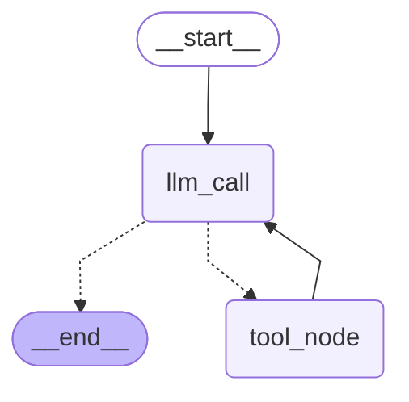

# iot-agent

AI Agent 应用练习项目：FastAPI 服务 + 工具调用 + RAG 检索。

## 跑起来
python -m pytest -q          # 3 passed
uvicorn app.main:app --reload

## 容器
docker build -t iot-agent .
docker run -p 8000:8000 --env-file .env iot-agent
curl.exe http://127.0.0.1:8000/health

## Agent 状态图
### 图结构：START → llm_call →(条件边)→ tool_node → llm_call → END

## Agent 架构图

- `llm_call -.-> tool_node`：上一条消息带 `tool_calls` 时去执行工具
- `llm_call -.-> __end__`：没有 `tool_calls` 就收口结束
- `tool_node --> llm_call`：工具结果回到模型，可再来一轮 —— **这个环就是 agent**

python -m app.graph          # 三轮记忆演示

python -m app.recursion_probe # 熔断探针（预期 GraphRecursionError）

## 下一步
LangGraph 状态图 / 工具工程化 / RAG + 评测