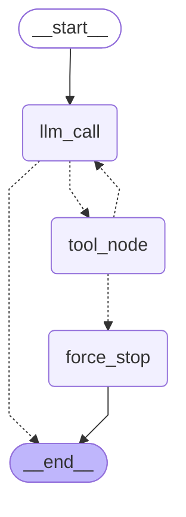

# iot-agent

AI Agent 应用练习项目：FastAPI 服务 + 工具调用 + RAG 检索。

## 跑起来
python -m pytest -q          # 3 passed  
uvicorn app.main:app --reload

## 容器
docker build -t iot-agent .  
docker run -p 8000:8000 --env-file .env iot-agent  
curl.exe http://127.0.0.1:8000/health  

## Agent 架构图
图结构：START → llm_call →(条件边)→ {tool_node, END}；tool_node →(条件边)→ {llm_call, force_stop}；force_stop → END

- llm_call -.-> tool_node：上一条消息带 tool_calls 时去执行工具
- llm_call -.-> __end__：没有 tool_calls 就收口结束
- tool_node -.-> llm_call：工具结果回到模型，可再来一轮 —— 这个环就是 agent
- tool_node -.-> force_stop：同一工具连续 3 次没有可用结论，不再回模型，强制收口
- force_stop --> __end__：兜底回答由本地生成，不调模型（零 token）

python -m app.graph          # 三轮记忆演示
python -m app.recursion_probe # 熔断探针（预期 GraphRecursionError）

## 工具错误的三种处理
工具调用统一走 run_tool_safely()：异常不向上抛，统一转成 ToolMessage 回灌给模型，由模型自己收口。

- 超时：asyncio.timeout(3s) 打断等待 → 返回 status="error" 的 ToolMessage「工具 X 超过 3s 未返回」→ 用户看到一句人话 + 「稍后重试」，服务不卡死
- 上游 500 / 任意异常：捕获后只回灌异常类名（堆栈与响应体不进上下文）→ 用户看到「该信息暂时不可用」，模型不编造，图不中断
- 越权：唯一入口 authorize() 查表拦截 + 写审计 → status="error"，文案明说业务拒绝、重试不会改变结果并给出下一步 → 用户看到「无权限，该设备不属于当前租户」+ 找管理员，模型不换设备绕过

配套两条：

- 幂等：create_ticket 以 (tenant_id, idem_key) 为键，重复提交返回既有单号（幂等命中，未重复创建）—— 写操作能安全重试的前提。演示用进程内字典，生产用唯一索引
- 熔断：同一工具连续 3 次没有可用结论 → after_tool_node 路由到 force_stop（不调模型）→ 输出「我暂时无法完成…」。熔断只止损，不解决问题

python -m pytest -q tests/test_tools.py    # 7 passed：超时 / 500 / 节点不抛 / 越权+审计 / 幂等 / 熔断

## 下一步
LangGraph 状态图 / 工具工程化 / RAG + 评测