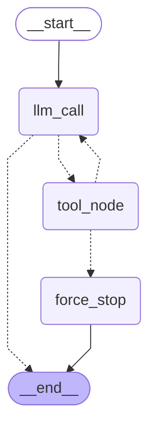

# iot-agent

AI Agent 应用练习项目：FastAPI 服务 + 工具调用 + RAG 检索。

## 跑起来
python -m pytest -q          # 10 passed  
uvicorn app.main:app --reload

## 容器
docker build -t iot-agent .  
docker run -p 8000:8000 --env-file .env iot-agent  
curl.exe http://127.0.0.1:8000/health  

## Agent 架构图
图结构：START → llm_call →(条件边)→ {tool_node, END}；tool_node →(条件边)→ {llm_call, force_stop}；force_stop → END

- llm_call -.-> tool_node：上一条消息带 tool_calls 时去执行工具
- llm_call -.-> __end__：没有 tool_calls 就收口结束
- tool_node -.-> llm_call：工具结果回到模型，可再来一轮 —— 这个环就是 agent
- tool_node -.-> force_stop：同一工具连续 3 次没有可用结论，不再回模型，强制收口
- force_stop --> __end__：兜底回答由本地生成，不调模型（零 token）

python -m app.graph          # 三轮记忆演示
python -m app.recursion_probe # 熔断探针（预期 GraphRecursionError）

## 工具错误的三种处理
工具调用统一走 run_tool_safely()：异常不向上抛，统一转成 ToolMessage 回灌给模型，由模型自己收口。

- 超时：asyncio.timeout(3s) 打断等待 → 返回 status="error" 的 ToolMessage「工具 X 超过 3s 未返回」→ 用户看到一句人话 + 「稍后重试」，服务不卡死
- 上游 500 / 任意异常：捕获后只回灌异常类名（堆栈与响应体不进上下文）→ 用户看到「该信息暂时不可用」，模型不编造，图不中断
- 越权：唯一入口 authorize() 查表拦截 + 写审计 → status="error"，文案明说业务拒绝、重试不会改变结果并给出下一步 → 用户看到「无权限，该设备不属于当前租户」+ 找管理员，模型不换设备绕过

配套两条：

- 幂等：create_ticket 以 (tenant_id, idem_key) 为键，重复提交返回既有单号（幂等命中，未重复创建）—— 写操作能安全重试的前提。演示用进程内字典，生产用唯一索引
- 熔断：同一工具连续 3 次没有可用结论 → after_tool_node 路由到 force_stop（不调模型）→ 输出「我暂时无法完成…」。熔断只止损，不解决问题

python -m pytest -q tests/test_tools.py    # 7 passed：超时 / 500 / 节点不抛 / 越权+审计 / 幂等 / 熔断

## RAG 检索与评测
20 条评测集（17 正样本 + 3 负样本），三个配置一次跑完：python -m eval.run --config all

|配置 | 命中@1 | 命中@4 |关键词|拒答率|P95 延迟 | 平均 token |
 |---|---|---|---|---|---|---|
|朴素切块（500/0，不重排）	|53%	|100%	|100%	|100%|	2.3s	|1271
|结构切块（按 ## 切，不重排）	|76%	|100%	|100%	|100%	|2.1s	|1191
|结构切块 + CrossEncoder 重排 + 阈值 0.5	|82%	|100%	|100%	|100%	|8.4s	|870

- 命中@4 已饱和（三组都 100%）：语料只有 20 份手册、每份约 2.2KB，top-4 基本覆盖同一份文件，该指标在这份语料上没有区分度。能看出差别的是命中@1：切片贡献 +23pp（53% → 76%），重排再贡献 +6pp（76% → 82%）。
- 重排的代价必须一起写：P95 延迟 2.1s → 8.4s（4.1×），因为 CPU 上 10 对候选各过一次 cross-encoder，约 0.5s/对。默认开启，RERANK=kw 可退回 bigram 排序；是否值得要等 trace 量化后再定。
- 阈值 MIN_RERANK = 0.5 已用 20 条复核：3 条负样本 top-1 精排分 0.0199 / 0.0052 / 0.0001，17 条正样本 top-1 最低 0.6723，间隔干净（余量 0.17）。它的两个作用：① 负样本直接走零 token 确定性分支（1136–1249 → 0 token）；② 正样本上下文瘦身，7 条从 4 块砍到 1–3 块且未丢答案，正样本平均 token −20%，全 20 条平均 −32%。
- 局限：样本 20 条、单次运行（延迟与 token 有跑间抖动，同一配置两次跑 P95 为 2321 / 2979 ms）；RERANK=kw 退化分支的打分是汉字 bigram 重叠率，与 cross-encoder 不同尺度，不受 0.5 约束 —— 它能排序，不能判「无材料」。
## 下一步
LangGraph 状态图 / 工具工程化 / RAG + 评测